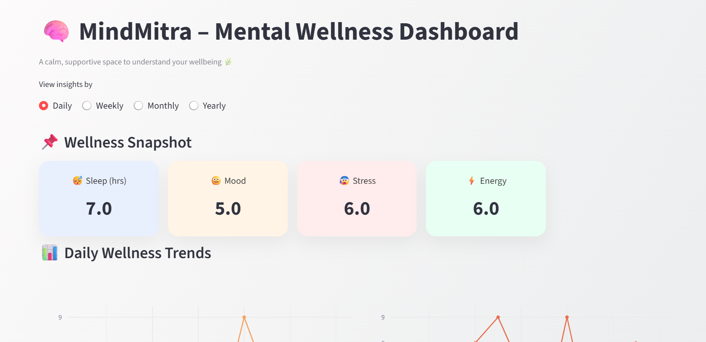
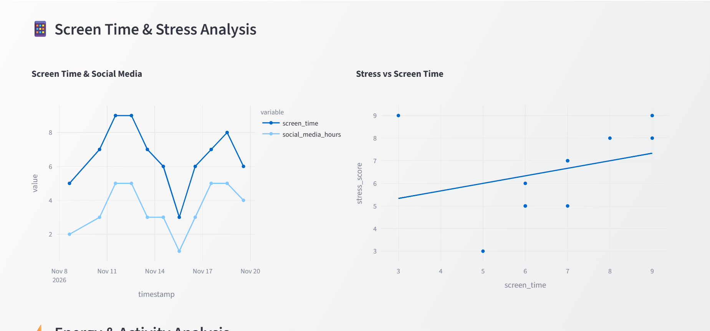
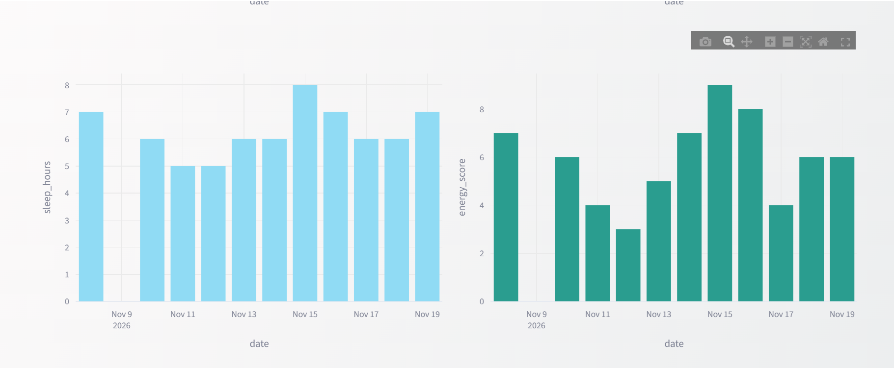
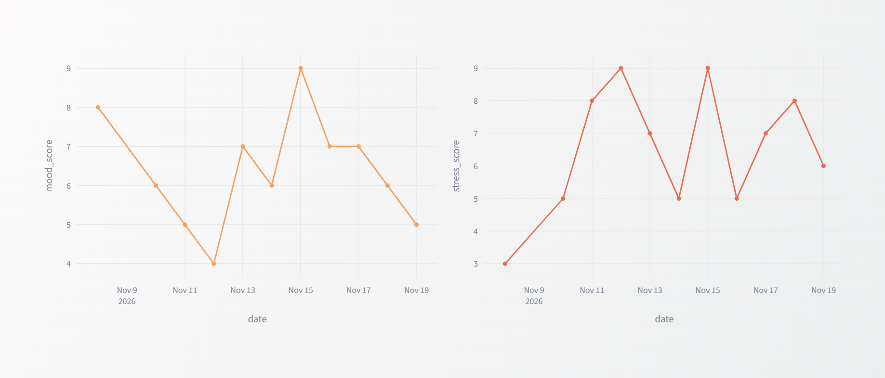
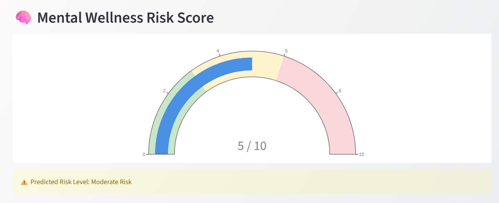
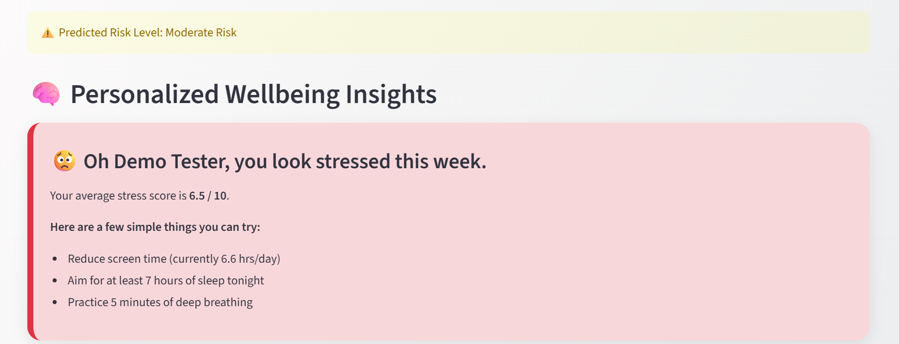

# MindMitra -- Mental Health Analysis & Wellness Support System

MindMitra is a web-based wellness support project that combines daily
wellness check-ins, data visualisation, and machine-learning workflows
to help users explore patterns in mood, stress, sleep, energy, screen
time, and physical activity.

The project was originally developed and analysed using a real collected
wellness-response dataset. That dataset is **not included in this public
repository** because it contains user-provided information and must be
protected for privacy. A separate synthetic dataset and demonstration
model are included so that the public repository can showcase the
workflow without exposing the original records.

> **Important model note:** The public repository includes
> `mental_health_demo_model.pkl`, which is trained using synthetic
> demonstration data. Its target labels are generated using predefined
> rules based on stress score and sleep hours. The resulting test
> accuracy reflects how well the model reproduces those rules on the
> synthetic test split; it is not evidence of clinically validated
> mental-health prediction. The original real-data training work is part
> of the project development, but the private dataset is not distributed
> here. MindMitra is not a diagnostic or medical tool.

## Project features

-   **User account workflow:** Flask-based signup, login, logout, and
    session handling.
-   **Daily wellness check-ins:** Records wellness information such as
    mood, stress, energy, sleep, screen time, social-media use, physical
    activity, and social interaction.
-   **Wellness dashboard:** Streamlit and Plotly visualisations for
    exploring wellness trends and relationships.
-   **Sentiment feature engineering:** TextBlob polarity scores are
    calculated from text responses in the model-training workflow.
-   **Machine-learning workflow:** Random Forest classification with
    three demonstration categories: Low Risk, Moderate Risk, and High
    Risk.
-   **Wellness activities:** Frontend activities include guided
    breathing and other wellness exercises.

## Dashboard preview

The following screenshots show the dashboard interface and
visualisations. 

## Dashboard Preview

### 1. Dashboard Overview



### 2. Wellness Trends

**Mood and Stress Analysis**



**Sleep and Energy Analysis**



**Additional Wellness Trends**



### 3. Mental Wellness Risk Assessment

**Risk Score Visualization**



**Personalized Wellness Insights**



**Wellness Recommendations**


## Technology stack

  Area                        Technologies
  --------------------------- -----------------------------
  Frontend                    HTML, CSS, JavaScript
  Backend                     Python, Flask, Flask-CORS
  Database                    SQLite
  Dashboard                   Streamlit, Plotly
  Data processing             Pandas, NumPy
  Machine learning            scikit-learn, Random Forest
  Sentiment analysis          TextBlob
  Model persistence           joblib
  Environment configuration   python-dotenv

## Repository structure

``` text
Mental_Health_Analysis_Github/
├── backend/
│   ├── app.py
│   └── database.py
├── dashboard/
│   └── dashboard.py
├── data(Synthetic)/
│   └── demo_wellness_data.csv
├── model/
│   └── mental_health_demo_model.pkl
├── notebooks/
│   └── Feature_engineering_demo.ipynb
├── scripts/
│   ├── generate_synthetic_data.py
│   └── synthetic_database.py
├── website/
│   ├── static/
│   └── template/
├── docs/
│   └── images/
├── .env.example
├── .gitignore
├── README.md
└── requirements.txt
```

This is the intended public structure. Keep any additional frontend
assets or documentation files that are required by your actual
application.

## Setup and run

### 1. Download the repository

Download the repository as a ZIP file from GitHub and extract it, then
open the project root folder in VS Code.

### 2. Create and activate a virtual environment (recommended)

On Windows PowerShell:

``` powershell
python -m venv .venv
.venv\Scripts\Activate.ps1
```

### 3. Install dependencies

``` bash
python -m pip install --upgrade pip
pip install -r requirements.txt
```

### 4. Configure the Flask secret key

The actual `.env` file is intentionally not included because it contains
a private Flask session secret.

1.  Copy `.env.example` and rename the copy to `.env` in the project
    root.
2.  Generate a secret key:

``` bash
python -c "import secrets; print(secrets.token_hex(32))"
```

3.  Put the generated value in the root `.env` file:

``` env
FLASK_SECRET_KEY=paste_your_generated_secret_here
```

Do not commit your real `.env` file or share its secret key.

### 5. Run the Flask application

From the project root:

``` bash
python backend/app.py
```

Use the local address printed by Flask in your terminal to open the
website.

### 6. Run the Streamlit dashboard

Open a second terminal at the project root and run:

``` bash
streamlit run dashboard/dashboard.py
```

Streamlit will print the local dashboard URL in the terminal.

## Data and privacy

-   The project was originally explored and developed using a real
    collected wellness-response dataset.
-   The original dataset is not published in this repository because it
    contains user-provided information and is being withheld to protect
    privacy.
-   `data(Synthetic)/demo_wellness_data.csv` is a synthetic dataset
    provided for public demonstration.
-   `database(Synthetic)/mindmitra.db` is the SQLite database currently
    referenced by the dashboard configuration.
-   The scripts in `scripts/` generate synthetic demonstration data and
    a synthetic database. Review their output paths before running them
    because they may create or overwrite generated files.

Do not upload real users' personal wellness records, credentials,
database files containing private records, or secret keys to a public
repository.

## Machine-learning workflow

The public demonstration notebook
`notebooks/Feature_engineering_demo.ipynb` contains the synthetic-data
feature preparation and model-training workflow.

The workflow includes: 1. Loading the synthetic wellness dataset. 2.
Encoding categorical fields such as sleep quality, activity, age group,
and gender. 3. Creating sentiment polarity features from text responses
with TextBlob. 4. Preparing the 17 input features used by the
demonstration classifier. 5. Creating rule-based target labels: - High
Risk: stress score is at least 7 and sleep hours are below 6. - Moderate
Risk: otherwise, stress score is at least 5. - Low Risk: all other
records. 6. Training and evaluating a Random Forest classifier. 7.
Saving the demonstration model as `model/mental_health_demo_model.pkl`.

The dashboard loads the saved demonstration model and passes a 17-value
feature array to it. Some fields in the current dashboard prediction
array are placeholders (for example, sentiment and profile-related
features). Consequently, the displayed prediction is a software
demonstration and should not be interpreted as a validated individual
risk assessment.

The original real-data analysis and model-training work is distinct from
the synthetic demonstration model distributed in this repository. Do not
interpret the public demo model's metrics as the performance of the
original real-data model.

## Limitations and responsible use

-   The public demonstration dataset is synthetic and does not represent
    a clinical study.
-   The demonstration target categories are generated from predefined
    rules using stress score and sleep hours. Those same variables are
    also among the model inputs, so a high test score can result from
    the model learning the label-generation rules.
-   Synthetic test accuracy must not be presented as clinical accuracy
    or proof of real-world generalisation.
-   The model has not been clinically validated and must not be used to
    diagnose, screen, or make treatment decisions.

## Future improvements

-   Align every dashboard inference feature with the values and
    transformations used during model training; remove placeholder
    inputs.
-   Evaluate with independently assigned labels and representative,
    consented data where appropriate.
-   Use cross-validation and report per-class precision, recall, and
    F1-score.
-   Add tests and documented database initialisation steps for a fresh
    installation.
-   Improve deployment configuration and user data protection.


